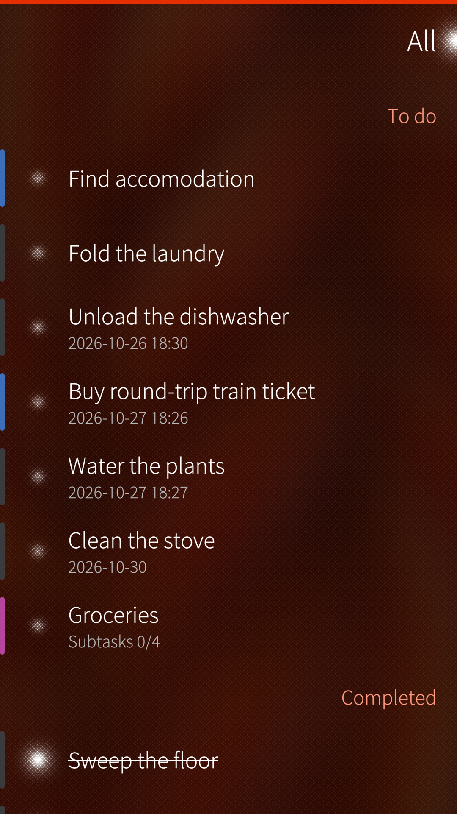
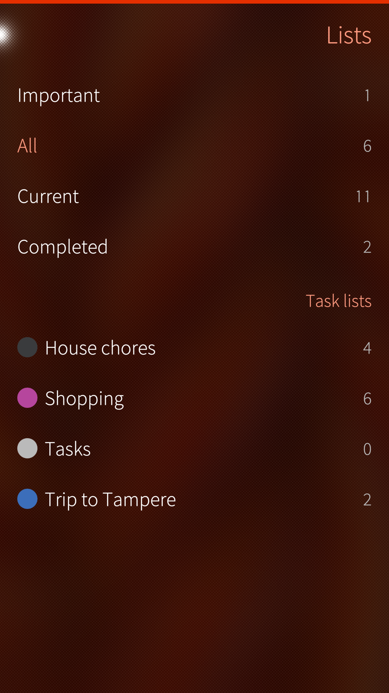
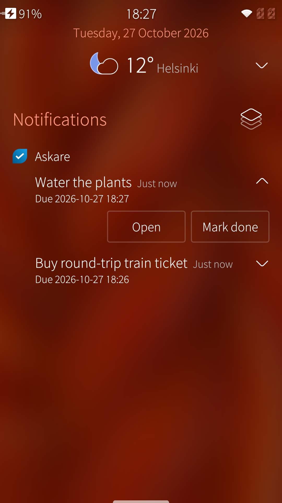

# Askare

Askare is a native [Nextcloud Tasks](https://apps.nextcloud.com/apps/tasks) client for Sailfish OS. It talks over CalDAV to a Nextcloud server that you already run, and keeps a copy of the lists on the device.

Askare does not use the Nextcloud account already in Settings. The system calendar only syncs events, so this app keeps its own copy of the tasks.

  

## Donate

The SailfishOS Community Team is on Liberapay:

## Features

  
 

- Add, edit and delete tasks with a name, completion, priority, start and due dates, and notes written in Markdown.
- Subtasks support.
- A reminder before a task is due.

## Requirements

- Sailfish OS 5.0 or newer
- A reachable Nextcloud server with the Tasks app

## Using Askare

[Using Askare](docs/guide.md) - signing in, working through the lists, editing tasks, reminders, and where your data lives.

## Download

RPMs are attached to the [GitHub releases](https://github.com/fravaccaro/harbour-askare/releases/latest).

## Developers

[Developers](docs/devel/) - architecture, building, deploying, and CI (maintainers and contributors).

## Translate

Request a new language or contribute on the [Transifex project page](https://explore.transifex.com/fravaccaro/askare).

## Credits

- [Nextcloud Tasks](https://apps.nextcloud.com/apps/tasks), the server app whose to-dos this client reads and writes.
- [Opal](https://github.com/Pretty-SFOS/opal) QML modules (About, SupportMe, LinkHandler) by [Mirian Margiani](https://github.com/Pretty-SFOS/opal-about).
- Thanks to all translators and testers.

## AI disclosure

- **Cursor-assisted work.** Askare is developed with [Cursor](https://cursor.com) as an IDE with AI assistance, for tasks such as scaffolding, documentation, translation upkeep and RPM packaging. Output is reviewed and edited by the maintainer before commit.
- **Not a substitute for testing.** AI suggestions do not replace testing on Sailfish OS hardware, reading the code, or applying your own knowledge. Generated changes are treated like any other patch: understand it, test it, then ship it.

## Licence

[GPL-3.0-only](https://github.com/fravaccaro/harbour-askare/blob/main/LICENSE)
